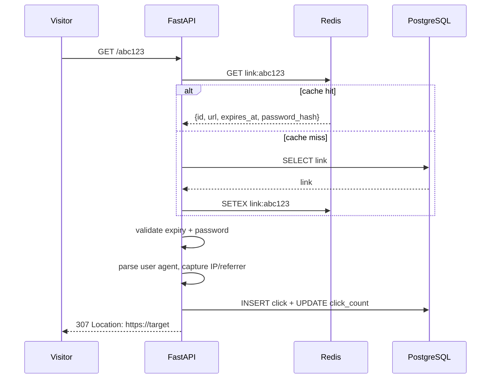

# LinkHub

A URL shortener built with **FastAPI**, **PostgreSQL** and **Redis**. Short links
resolve through a cache-aside Redis lookup, every click is recorded with
browser / OS / device / referrer breakdowns, and links can be password
protected, given a custom alias or made to expire on a schedule.

> **Live:** <https://linkhub-4b40.onrender.com> · **API docs:** `/docs`

[](https://github.com/Aditya-k63/LinkHub/actions/workflows/ci.yml)
[](https://www.python.org/)
[](https://fastapi.tiangolo.com/)
[](LICENSE)

---

## Why it exists

This started as a weekend project to stop pasting enormous URLs into chat.
Building it turned into an exercise in the parts of a backend that are
usually hidden: cache invalidation, rate limiting that actually limits,
migrations, observability, and what happens when a dependency is down.

It is also the project that taught me that **a feature that is not wired up
is not a feature**. The first version of this repository had a redirect
route that was never registered, a click queue nobody consumed, and a rate
limiter that swallowed its own `429`. The [Design decisions](#design-decisions)
section explains how those were found and fixed.

---

## Architecture

```mermaid
flowchart LR
    Browser[Browser] -->|GET /{short_code}| App[FastAPI]
    App -->|cache hit| Redis[(Redis)]
    App -->|cache miss| DB[(PostgreSQL)]
    App -->|record click| Redis
    Redis -->|click queue| Worker[Worker]
    Worker -->|insert Click| DB
    App -->|JSON API| Browser
```

### The click pipeline



The redirect is a **307**, so the method and body are preserved rather than
being rewritten to a `GET`.

---

## Features

| | Feature | Notes |
|---|---|---|
| ✅ | URL shortening | Random 6-character codes or a custom alias |
| ✅ | Redis cache-aside redirects | Hot links are served without touching the database |
| ✅ | Click analytics | Browser, OS, device, referrer and IP per click, with daily series |
| ✅ | Bot detection | Automated clients are flagged and excluded from human-facing totals |
| ✅ | Password-protected links | The destination is only served once the password matches |
| ✅ | Expiring links | Optional expiry, cleaned up by a periodic worker task |
| ✅ | Custom aliases | Validated for length, character set and reserved words |
| ✅ | JWT authentication | PyJWT, bcrypt password hashing, no usable default secrets |
| ✅ | Per-route rate limiting | Atomic Redis counters, `Retry-After` header, local fallback |
| ✅ | QR codes | PNG endpoint plus a data-URI in the JSON response |
| ✅ | Alembic migrations | Schema is versioned, not created with `create_all` |
| ✅ | Health checks | `/health` probes the database and returns `503` when it is down |
| ✅ | Structured logging | One JSON object per line, correlated by `X-Request-ID` |
| ✅ | Docker | Multi-stage image, non-root user, health check |
| ✅ | CI | Lint, types, tests against real PostgreSQL + Redis, migrations, image build, dependency audit |
| ✅ | Load testing | Locust scenarios for the redirect and create paths |
| ⏳ | Custom domains | Not implemented |
| ⏳ | Link bundles | Not implemented |

---

## Tech stack

- **FastAPI** 0.162 · **Uvicorn** 0.54
- **SQLAlchemy** 2.1 (ORM) · **Alembic** 1.20 (migrations)
- **PostgreSQL** 16 (Neon in production) · **SQLite** for local development
- **Redis** 8 (cache, rate limiting, click queue)
- **PyJWT** + **bcrypt**
- **Pydantic** v2 · **pydantic-settings**
- **Jinja2** + vanilla JS for the server-rendered frontend
- **Docker**, **GitHub Actions**, **Locust**, **Ruff**, **mypy**, **pytest**, **pip-audit**

---

## Running it locally

### The quick way (no servers needed)

```bash
git clone https://github.com/Aditya-k63/LinkHub.git
cd LinkHub

python -m venv .venv
source .venv/bin/activate          # Windows: .venv\Scripts\activate
pip install -r requirements-dev.txt

cp .env.example .env               # Windows: copy .env.example .env
uvicorn app.main:app --reload
```

Open <http://localhost:8000>. SQLite is used by default and Redis is
optional - the app detects whether it is reachable and degrades gracefully.

### The full stack

```bash
docker compose up --build
```

This starts the app, PostgreSQL and Redis with health checks and waits for
the databases to be ready.

To run the click worker as well:

```bash
docker compose --profile worker up --build
```

### Configuration

Every setting comes from the environment. The important ones:

| Variable | Default | Description |
|---|---|---|
| `ENVIRONMENT` | `development` | `production` enables the strict startup checks |
| `SECRET_KEY` / `JWT_SECRET_KEY` | *placeholder* | **Must be changed.** The app refuses to start in production with the placeholders |
| `DATABASE_URL` | `sqlite:///./linkhub.db` | PostgreSQL in production |
| `REDIS_URL` | *(empty)* | Enables caching and shared rate limits |
| `BASE_URL` | `http://localhost:8000` | The origin short links are built from |
| `CORS_ORIGINS` | localhost origins | Comma separated allowlist; required in production |
| `RATE_LIMIT_PER_MINUTE` | `100` | Budget per minute; reads get 5x this |
| `CLICK_WRITE_MODE` | `sync` | `async` queues clicks for a worker to persist |

---

## API

| Method | Path | Auth | Description |
|---|---|---|---|
| `POST` | `/api/auth/register` | – | Create an account, returns a JWT |
| `POST` | `/api/auth/login` | – | Exchange credentials for a JWT |
| `GET` | `/api/auth/me` | ✅ | The current user's profile |
| `POST` | `/api/links` | ✅ | Create a short link |
| `GET` | `/api/links` | ✅ | List your links (paginated) |
| `GET` | `/api/links/{short_code}` | – | Resolve to a destination (records a click) |
| `PUT` | `/api/links/{link_id}` | ✅ | Update the URL, title, expiry or active flag |
| `DELETE` | `/api/links/{link_id}` | ✅ | Delete a link |
| `GET` | `/api/links/{short_code}/exists` | – | Check whether an alias is free |
| `GET` | `/api/analytics/{link_id}` | ✅ | Click analytics for a link |
| `GET` | `/api/analytics/{link_id}/series` | ✅ | Daily click series |
| `GET` | `/api/qr/{short_code}.png` | – | QR code as a PNG |
| `GET` | `/{short_code}` | – | **The redirect** |
| `GET` | `/api/admin/stats` | ✅ admin | Platform counters |
| `GET` | `/api/admin/users` | ✅ admin | List users |
| `GET` | `/health` | – | Readiness probe |

Example:

```bash
TOKEN=$(curl -s -X POST http://localhost:8000/api/auth/register \
  -H 'Content-Type: application/json' \
  -d '{"email":"me@example.com","username":"me","password":"a-good-password"}' \
  | python -c 'import json,sys; print(json.load(sys.stdin)["access_token"])')

curl -s -X POST http://localhost:8000/api/links \
  -H "Authorization: Bearer $TOKEN" -H 'Content-Type: application/json' \
  -d '{"url":"https://github.com/Aditya-k63/LinkHub","custom_alias":"repo"}'

curl -i http://localhost:8000/repo     # 307 Location: https://github.com/...
```

---

## Performance

Measured with the Locust scenarios in `scripts/loadtest/locustfile.py`, which
mix redirect traffic with link creation the way real usage does.

**Environment:** Windows 11 · 4 vCPU · Python 3.11 · a single Uvicorn worker ·
file-backed SQLite in WAL mode · **no Redis** · click writes inline.

| Concurrency | Requests | Failures | Throughput | p50 | p95 | p99 |
|---|---|---|---|---|---|---|
| 10 users | 244 | 0 | 13 req/s | 11 ms | 46 ms | 190 ms |
| 50 users | 1 554 | 0 | 54 req/s | 52 ms | 310 ms | 1 400 ms |

```bash
locust -f scripts/loadtest/locustfile.py --host http://localhost:8000 \
       --users 50 --spawn-rate 25 --run-time 30s --headless
```

**These are a floor, not a ceiling**, and it is worth being precise about
why:

- **No Redis.** Every redirect reads the link from the database. With the
  cache warm the read disappears and only the click write remains.
- **SQLite, not PostgreSQL.** Each redirect writes a `Click` row and
  increments a counter, so the redirect path is write-bound. PostgreSQL
  handles concurrent writers far better than SQLite does.
- **Clicks are written inline.** `CLICK_WRITE_MODE=async` moves that write
  onto a queue, taking it off the request path entirely.
- **One worker.** The container runs a single Uvicorn process; the read
  path is CPU-bound in Python, so it scales with cores.

The useful lesson from the load test was not the numbers - it was a crash.
The first run produced a steady stream of `500`s, because the SQLite engine
used `StaticPool` and every session shared a single connection, so two
concurrent commits fought over the same transaction. The fix is in
[app/db/session.py](app/db/session.py): in-memory SQLite keeps the shared
pool, file-backed SQLite gets a normal pool plus WAL mode.

---

## Testing

```bash
pytest                          # 38 tests
pytest --cov=app                # with coverage
python scripts/smoke_test.py    # end-to-end check of the whole flow
```

The suite runs against an in-memory SQLite database and a stubbed Redis, so
it needs no services and never touches real data. CI runs the same tests
against **real PostgreSQL and Redis service containers**, which is where
dialect differences (UUID handling, `func.date` grouping) actually show up.

Covered behaviours include: the 307 redirect and its `Location` header, click
recording, bot flagging, expiry returning `410`, password protection
returning `403`, disabled links returning `404`, alias validation, ownership
isolation between users, `401` on unauthenticated writes, `403` for
non-admins, `429` with `Retry-After` when the rate limit is hit, and the QR
endpoint.

---

## Design decisions

**Redis is optional, not required.** Every Redis call is wrapped so that a
cache miss, a Redis outage or a missing `REDIS_URL` degrades performance
instead of breaking the service. Rate limiting falls back to an in-process
fixed window. The app is fully functional without Redis; it is just slower.

**The redirect cache stores the whole link record, not just the URL.**
Expiry and password protection are checked on every request, so caching only
the destination would have meant the fast path could serve an expired or
protected link. The cached record holds the id, destination, expiry and
password hash, so a hit needs no database read at all.

**`307`, not `302`.** A `302` turns a `POST` into a `GET` and drops the
body. `307` preserves the method, which keeps the redirect correct for
non-GET clients.

**Clicks are written synchronously by default.** A queued write is faster
but makes the click count eventually consistent, and it needs a worker to
be running. `CLICK_WRITE_MODE=async` moves the write onto a Redis queue that
a worker drains, and the same code path serves both modes.

**A failed analytics write must never break a redirect.** If the click
cannot be persisted the transaction is rolled back and the error is logged,
but the visitor still gets their redirect. Losing one analytics row is
acceptable; losing the redirect is not.

**The rate limiter uses an atomic Redis script.** The original
implementation did `GET` then `INCR`, which loses increments under
concurrency. A tiny Lua script increments and sets the expiry in one
round trip. The `429` is raised *outside* the `try/except` block that
previously swallowed it.

**UUIDs are normalised at the boundary.** The models use the generic
`sqlalchemy.Uuid` type, which is a native `uuid` on PostgreSQL and
`CHAR(32)` on SQLite. Identifiers arriving from a URL path or a JWT claim
are strings, so they are converted with `uuid.UUID(...)` before they reach a
query rather than relying on the driver to coerce them.

**`ENVIRONMENT=production` changes the failure mode.** A development server
falls back to SQLite when the database is unreachable; a production server
refuses to start. Silently serving from a local file while the real database
is down is how the previous deployment ended up returning `200 healthy`
from `/health` while every database route returned `500`.

**SQLite is a development convenience, not a production database.** The
in-memory URL keeps a single shared connection so every session sees the
same data. A file-backed URL gets a normal connection pool plus WAL mode,
because a shared pool makes concurrent commits fail with *"cannot commit -
no transaction is active"*. PostgreSQL is used everywhere that matters.

---

## Project structure

```
LinkHub/
├── app/
│   ├── api/            # auth, links, analytics, admin, qr routers
│   ├── core/           # config, security, dependencies, logging, identifiers
│   ├── db/             # models and session management
│   ├── middleware/     # request identity, rate limiting
│   ├── services/       # redirect, click tracking, caching, analytics, QR
│   ├── workers/        # Celery tasks and a dependency-free consumer
│   └── main.py         # application wiring
├── alembic/            # versioned schema migrations
├── scripts/            # smoke test and load test
├── static/ templates/  # server-rendered frontend
├── tests/              # pytest suite
├── .github/workflows/  # CI pipeline
├── Dockerfile
└── docker-compose.yml
```

---

## Deployment

The app is deployed on Render with PostgreSQL and Redis. `render.yaml`
describes the service; `DATABASE_URL`, `REDIS_URL`, `BASE_URL` and
`CORS_ORIGINS` are set as dashboard secrets and migrations run via
`preDeployCommand`.

The Docker image is multi-stage, runs as a non-root user and ships a
`HEALTHCHECK` that polls `/health`.

---

## License

MIT - see [LICENSE](LICENSE).
